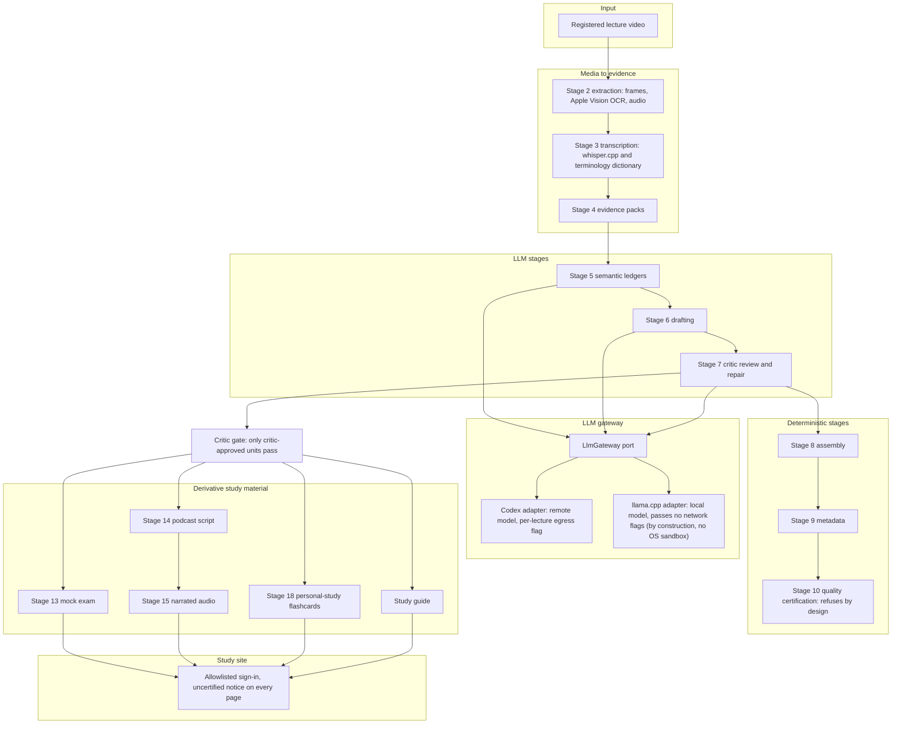

# lecture-to-study-pipeline

A macOS Apple Silicon command-line pipeline, plus a small authenticated study site, that turns a registered lecture video into frames, OCR text, a corrected transcript, evidence packs, critic-reviewed grounded drafts and student-facing study material: a study guide, flashcards, a mock exam and a narrated podcast.

Status: a study project. Every generated page is labelled as uncertified material. The repository holds a synthetic demo lecture authored for it and no real lecture data.

Terminology: this README says "stage N" for the numbered pipeline stages. The architecture decision records (ADRs) and the code call the same units "Phase N".

## Contents

- [The problem](#the-problem)
- [Architecture](#architecture)
- [Stage map](#stage-map)
- [Design decisions](#design-decisions)
- [Measured results](#measured-results)
- [Quick start](#quick-start)
- [End-to-end demo](#end-to-end-demo)
- [Operating boundaries](#operating-boundaries)
- [Status and limits](#status-and-limits)
- [Repository layout](#repository-layout)
- [License](#license)

## The problem

Lecture recordings are long, and model-generated study material is only useful if every statement is grounded in the lecture and a reviewer has accepted it. The pipeline's guarantee is narrow and mechanical: the four scripts that write student-facing material (mock exam, podcast, personal-study flashcards and study guide) read only critic-approved, post-repair units and refuse the whole lecture otherwise, and every site page that renders study material carries the uncertified notice. The site does not re-check how a file was produced, and material generated before the gate existed was not gated; it must be regenerated or deleted ([ADR 0045](docs/decisions/0045-critic-gate-for-derivative-material-egress-and-audience.md), section 1 and Consequences). Files served unchanged (PDF, audio, video) cannot carry the notice. The audience of the study site is an allowlist of signed-in people.

## Architecture



The exam, podcast and flashcards stages also call the gateway port; the edges are omitted to keep the diagram readable. Layering follows the dependency rule that the ADRs and the codebase record. The domain package sits at the center and imports no other project package. The gateway port and its inner modules import no adapter, the adapters and the factory are the outer modules, and `ops/` and `site/` never import `llm/` ([ADR 0046](docs/decisions/0046-pluggable-llm-gateway-and-local-adapter.md), decision 1, enforced by `tests/test_llm_layering.py`). The site imports no processing stage, and the container image copies only the site package and the domain models. Stages communicate through files under `workspace/data/`, and a stage is skipped when its output artifact already exists ([ADR 0016](docs/decisions/0016-master-cli-orchestrator.md)).

## Stage map

| Stage | Name | Produces | LLM-backed | ADRs |
| --- | --- | --- | --- | --- |
| 2 | extraction | Frames at scene changes, Apple Vision OCR text, extracted audio | no | [0002](docs/decisions/0002-extraction-orchestrator-contracts.md), [0021](docs/decisions/0021-scene-change-detection-threshold.md) |
| 3 | transcription | Transcript from whisper.cpp with a vocabulary prompt, then deterministic terminology correction | no | [0003](docs/decisions/0003-transcription-orchestrator-contracts.md), [0028](docs/decisions/0028-asr-vocabulary-prompt-and-terminology-correction.md) |
| 4 | evidence | Evidence packs of aligned transcript segments and slide text | no | [0004](docs/decisions/0004-evidence-pack-chunking-contracts.md) |
| 5 | semantic | Semantic ledgers, one per evidence pack | yes | [0005](docs/decisions/0005-semantic-ledger-extraction-contracts.md), [0046](docs/decisions/0046-pluggable-llm-gateway-and-local-adapter.md) |
| 6 | drafting | Learning-unit drafts grounded in evidence packs and ledgers | yes | [0006](docs/decisions/0006-learning-unit-draft-synthesis-contracts.md), [0046](docs/decisions/0046-pluggable-llm-gateway-and-local-adapter.md) |
| 7 | critic | Critic review and repair; validated units | yes | [0007](docs/decisions/0007-workspace-migration-and-critic-repair-loop.md), [0036](docs/decisions/0036-codex-critic-repair-loop-and-instruction-calibration.md), [0045](docs/decisions/0045-critic-gate-for-derivative-material-egress-and-audience.md) |
| 8 | assembly | One canonical lecture document from the validated units | no | [0008](docs/decisions/0008-document-assembly-and-domain-error-taxonomy.md) |
| 9 | metadata | Deduplicated glossary and clinical-fact index per lecture | no | [0009](docs/decisions/0009-deterministic-metadata-deduplication.md) |
| 10 | quality-certification | No certificate: refuses by design | no | [0023](docs/decisions/0023-content-completeness-quality-gates-and-parallel-execution.md), [0024](docs/decisions/0024-uncertified-personal-study-execution-mode.md) |
| 11 | publishing | Markdown study guide of the certified route | no | [0011](docs/decisions/0011-markdown-compilation-and-publishing-pipeline.md) |
| 12 | flashcards | Anki CSV deck of the certified route | no | [0012](docs/decisions/0012-deterministic-flashcard-generation.md) |
| 13 | exams | Mock exam, graded on the server | yes | [0013](docs/decisions/0013-llm-mock-exam-generation.md), [0030](docs/decisions/0030-critical-review-merge-and-codex-exam-route.md), [0041](docs/decisions/0041-server-graded-interactive-mock-exam.md) |
| 14 | podcast | Two-speaker podcast script | yes | [0014](docs/decisions/0014-llm-podcast-script-generation.md), [0037](docs/decisions/0037-codex-podcast-script-route.md) |
| 15 | tts | Narrated podcast audio with the Kokoro MLX engine | no | [0015](docs/decisions/0015-local-tts-audio-generation.md), [0032](docs/decisions/0032-kokoro-mlx-podcast-tts-engine.md) |
| 18 | personal-study flashcards | Flashcard deck from critic-approved units (standalone script, not an orchestrator stage) | yes | [0045](docs/decisions/0045-critic-gate-for-derivative-material-egress-and-audience.md), section 5 |
| - | study guide | Study-guide bundle for the site (script `scripts/generate_personal_study_guides.py`) | no | [0024](docs/decisions/0024-uncertified-personal-study-execution-mode.md), [0045](docs/decisions/0045-critic-gate-for-derivative-material-egress-and-audience.md) |
| - | site | Authenticated study site served from generated pages | no | [0029](docs/decisions/0029-study-site-scope-and-access.md), [0039](docs/decisions/0039-phone-sessions-and-edge-cache-isolation.md), [0040](docs/decisions/0040-dedicated-video-watch-page.md), [0041](docs/decisions/0041-server-graded-interactive-mock-exam.md), [0044](docs/decisions/0044-public-extraction-and-site-access-hardening.md) |

The ADRs and the code call stages "Phase N". The ADR sequence skips the records numbered 17 to 19 by design: they described portal acquisition, which is not part of this repository ([ADR 0044](docs/decisions/0044-public-extraction-and-site-access-hardening.md)). ADRs 0005, 0006, 0007, 0013 and 0014 are marked superseded by [ADR 0038](docs/decisions/0038-orchestrator-codex-integration-and-local-llm-route-removal.md) as to the local execution route of their time; [ADR 0046](docs/decisions/0046-pluggable-llm-gateway-and-local-adapter.md) later reintroduced a local route as an adapter of the gateway. The orchestrator is described in ADR 0016, and the demo in [ADR 0047](docs/decisions/0047-demo-lecture-measurement-method.md).

## Design decisions

| Decision | Why | ADR |
| --- | --- | --- |
| Critic gate; a blocked lecture is never published partially | The four derivative-material scripts load only post-repair units of `09_validated_units`; a rejected, missing, stale or mismatched unit blocks the whole lecture, because a reader could not tell that partial material was incomplete. The site does not re-check provenance, and material generated before the gate was not gated. | [0045](docs/decisions/0045-critic-gate-for-derivative-material-egress-and-audience.md), section 1 |
| Uncertified by design | Stage 10 keeps refusing, no artifact may be presented as certified or clinically approved, and every site page that renders study material says so. | [0024](docs/decisions/0024-uncertified-personal-study-execution-mode.md), [0045](docs/decisions/0045-critic-gate-for-derivative-material-egress-and-audience.md), section 3 |
| One LLM port, two adapters, egress enforced as code | The remote adapter runs only for lectures recorded as eligible, and the refusal happens before the executable is resolved; detecting patient-identifying data stays with the operator. | [0046](docs/decisions/0046-pluggable-llm-gateway-and-local-adapter.md) |
| ASR vocabulary prompt plus deterministic terminology correction | The prompt prevents meaning inversions at the source; a deterministic rewrite handles terms the prompt cannot fix, and its audit record is written before the transcript. | [0028](docs/decisions/0028-asr-vocabulary-prompt-and-terminology-correction.md) |
| Student-facing text guard | The critic cannot catch language or referring-phrase defects, so a mechanical guard sits inside the bounded retry and no defective artifact is written; the prompt alone was rejected because the first run after the prompt fix still produced six questions with a referring phrase. | [0027](docs/decisions/0027-student-facing-text-guard.md) |
| Filesystem-artifact resume in the orchestrator | Stages communicate through files, a stage whose output artifact exists is skipped on rerun, and stages 5 to 7 are scoped to the requested lecture. | [0016](docs/decisions/0016-master-cli-orchestrator.md) |
| Server-graded mock exam | The answer key is stripped before any response and the exam file is read from disk, never mounted as a static tree. | [0041](docs/decisions/0041-server-graded-interactive-mock-exam.md) |
| Site access with per-person revocation and a hash-based Content-Security-Policy | Session tokens are signed with a key that mixes a server secret with one person's password hash, so removing a line revokes exactly that person; inline code is admitted only by its hash. | [0029](docs/decisions/0029-study-site-scope-and-access.md), [0039](docs/decisions/0039-phone-sessions-and-edge-cache-isolation.md), [0044](docs/decisions/0044-public-extraction-and-site-access-hardening.md) |
| Private publication gate for local lectures | A local lecture is unpublished by default and compiles into a private tree; publishing needs an explicit flag and a recompile. | [0042](docs/decisions/0042-local-lectures-private-publication-gate.md) |
| Leak gate before going public | Local hooks and CI scan content, names and history against a private denylist and for secrets. | [0044](docs/decisions/0044-public-extraction-and-site-access-hardening.md), section 3 |
| Measurement method | Every rate is printed with its denominator, the word error rate has a fixed definition, and the run is harvested before the recovery can overwrite it. | [0047](docs/decisions/0047-demo-lecture-measurement-method.md) |
| At-rest encryption delegated to FileVault | Application-level encryption would add key management with no benefit on a single machine already covered by full-disk encryption; the acceptance has stated revisit triggers. | [0010](docs/decisions/0010-local-pii-encryption-risk-acceptance.md) |

## Measured results

The full report is [docs/results/demo-results.md](docs/results/demo-results.md), and the method is recorded in [ADR 0047](docs/decisions/0047-demo-lecture-measurement-method.md). Only headline figures are repeated here, each with its denominator.

- Lecture: 243.6 s of video and 620 reference words.
- ASR word error rate, pipeline condition (vocabulary prompt on): 2.3% (14 of 620 words) before the terminology dictionary and 0.5% (3 of 620 words) after it. Ablation (vocabulary prompt off): 3.1% (19 of 620 words) before and 0.0% (0 of 620 words) after. The figures are the same for both lecture ids, which register the same video.
- First-attempt schema pass rate of the exams stage: 100.0% (16 of 16 requests) with the Codex adapter and 87.5% (14 of 16 requests) with the local adapter.
- Critic rejection rate: 0.0% (0 of 1 reviews) for both adapters.
- Blocked-lecture recovery on the local adapter: podcast and study guide recovered in 10 of 10 scenario runs, flashcards in 6 of 6 at a deck floor of 5 and 0 of 4 at the default floor of 12, and the mock exam in 1 of 10.

Limits of these figures:

- The Codex figures are one evidence pack of one run with the model named in the report, gpt-6-sol. The local figures are one evidence pack of one run on one machine. The numbers describe those runs and are not a benchmark.
- Remote wall times include provider latency and are not comparable with local inference time. Per-stage wall times are in the report.
- DEMO-04 is only partly met. Blocking and critic re-approval were shown in every run. The mock exam recovered in 1 of 10 scenario runs, which the report and the ADR attribute to contract failures of the local model, not to the gate.

## Quick start

Requirements, as the repository files state them:

- Apple Silicon macOS. OCR uses Apple Vision and narration uses MLX ([ADR 0001](docs/decisions/0001-apple-silicon-quartz.md), and the macOS job of the CI workflow).
- Python 3.12, managed by [uv](https://docs.astral.sh/uv/) (`.python-version`).
- Homebrew, `git` and `cmake`, plus a C/C++ toolchain (Xcode command line tools). The provisioning script installs `ffmpeg`, `typst` and `huggingface-cli`, then clones and builds whisper.cpp and llama.cpp with `git` and `cmake`, which it does not install; the CI job additionally installs `poppler` and `gitleaks`.

```bash
uv sync --group dev
bash scripts/01_provision_engines.sh --with-example-llm-model
cp config/llm-gateway.example.yaml config/llm-gateway.local.yaml
make lint
make test
```

The provisioning script builds whisper.cpp and llama.cpp with Metal, downloads the speech model and, with the opt-in flag, the example local text model. The example model is about 9 GB and pinned by revision and shard digests ([ADR 0046](docs/decisions/0046-pluggable-llm-gateway-and-local-adapter.md), decision 5). The first narration run downloads the Kokoro voice model once ([ADR 0032](docs/decisions/0032-kokoro-mlx-podcast-tts-engine.md)). The local gateway configuration selects the adapter; the versioned example documents every key.

`make docs-check` is a static check of this README and of `docs/operations.md`. It checks the commands inside shell-labelled code fences (make targets and variables, repository scripts and modules, subcommand names and long options by textual presence in the source), paths that start with a tracked directory, link targets that are files (anchors, the part after `#`, are not checked), ADR numbers, that each blockquote occurs verbatim in some ADR, and that no home-directory path appears. It does not check `make` commands written in running text, root-level files such as `Dockerfile.site` or `pyproject.toml`, bare package paths such as `ops/`, commands in unlabelled fences, or which ADR a quotation is attributed to.

`make hooks` installs the leak-gate git hooks. They read a private denylist that is kept outside the repository ([ADR 0044](docs/decisions/0044-public-extraction-and-site-access-hardening.md), section 3), and no term of it is named here.

```bash
make hooks
make docs-check
```

## End-to-end demo

The demo runs a six-slide Brazilian Portuguese synthetic lecture through the pipeline to a served page. The video is rebuilt from `demo/lecture/script.yaml`, which was authored for this repository and holds no third-party content and no patient data. The same video is registered twice: one registration is local-only, the other is cleared for the remote adapter ([ADR 0047](docs/decisions/0047-demo-lecture-measurement-method.md), decision 4). The steps run in this order from the repository root.

Step 1 builds the lecture video from the script (slides, narration and composition).

```bash
make demo-video
```

Step 2 registers the two lecture ids, 925100 for the local adapter and 925101 for the remote adapter.

```bash
make demo-register
```

Step 3 checks the engines, the model files and the egress policy before anything runs. The output is `preflight=ok` or `preflight=refused`.

```bash
make demo-preflight
```

Step 4 runs the driver with the local adapter. The driver runs four steps in order: `run-all` (stages 2 to 9 complete, and stage 10 refuses by design because no certificate is issued), `run-personal-study` (stages 8, 9, 13, 14 and 15), the stage 18 personal-study flashcards script and the study-guide script.

```bash
make demo-run
```

Step 5 prepares the throwaway sign-in material of the demo site, generates the pages, serves them over local HTTPS and checks the signed-in view. The sign-in values stay in a gitignored location under `workspace/demo/` and are never printed. `make demo-serve` occupies its terminal, so the check runs in a second one.

```bash
make demo-site-access
make demo-site
make demo-serve
```

```bash
make demo-check
```

The check prints one line with the lecture id, the status of an anonymous request, the status of the sign-in, the status of the lecture page and whether the uncertified notice is present.

Step 6 harvests the measured artifacts of the run and only then induces and recovers the blocked states ([ADR 0047](docs/decisions/0047-demo-lecture-measurement-method.md), decision 5; the recovery reruns the critic and replaces its record). Step 7 regenerates the results report.

```bash
make demo-harvest
make demo-recovery
make demo-report
```

### Variables

| Variable | Default | Meaning |
| --- | --- | --- |
| `WHISPER_MODEL_PATH` | `engines/whisper.cpp/models/ggml-large-v3-turbo.bin` | Speech model passed to the transcription stage. |
| `DEMO_LOCAL_ID` | `925100` | Lecture id registered without the remote flag. |
| `DEMO_CODEX_ID` | `925101` | Lecture id registered with the remote flag. |
| `ADAPTER` | `llama-cpp` | LLM adapter of the driver: `llama-cpp` (local) or `codex` (remote). |
| `LECTURE` | `DEMO_LOCAL_ID` | Lecture id used by preflight, run, harvest and check. |
| `CONFIRM_REMOTE_EGRESS` | empty | The value `yes` passes the egress confirmation flag. |
| `FROM_STEP` | `run_all` | First driver step to run: `run_all`, `personal_study`, `flashcards` or `study_guide`. |
| `FLASHCARDS_MINIMUM_TOTAL_CARDS` | empty | Deck floor override for the flashcards stage; the stage default is 12. |

The measured local run used a deck floor of 5, because the local model did not reach the default floor of 12 for the one-unit lecture, as the results report records:

```bash
make demo-run FLASHCARDS_MINIMUM_TOTAL_CARDS=5
```

### Codex variant

The remote adapter sends lecture content to a remote provider. It is refused without the confirmation variable, and `docs/operations.md` is required reading before it is used. The first command below is refused by design (exit code 2) because the confirmation is absent. The second is documentation only: it passes the confirmation and sends the synthetic lecture to the provider.

```bash
make demo-preflight ADAPTER=codex LECTURE=925101
make demo-run ADAPTER=codex LECTURE=925101 CONFIRM_REMOTE_EGRESS=yes
```

### Walkthrough verification

The walkthrough was checked on 2026-10-16 as follows.

- Static check: `make docs-check` over this README and `docs/operations.md`, within the limits stated in the quick start (fenced commands, tracked-directory paths, link files without anchors, ADR numbers, verbatim blockquotes).
- Executed on 2026-10-16: `make docs-check` (exit code 0); a dry run (`make -n`) of every demo target and of the variable forms shown above, each expanding to the expected script and adapter; `make demo-preflight` with the local adapter (`preflight=ok`); the refusal path `make demo-preflight ADAPTER=codex LECTURE=925101` without the confirmation variable (refused by design, exit code 2, nothing sent); `make demo-report` (exit code 0, the regenerated results report equal to the committed one); `make demo-site` (one line per demo lecture); and the served page, with `make demo-serve` started, `make demo-check` run for both lectures (anonymous request refused with status 401, sign-in redirected with status 303, lecture page status 200, uncertified notice present) and the server stopped afterwards.
- Not re-executed, cited to the Phase 7 run and to [the results report](docs/results/demo-results.md): the provisioning script, `make demo-video`, `make demo-register`, `make demo-run` (both adapters), `make demo-harvest`, `make demo-recovery` and `make demo-site-access` (the throwaway certificate was still valid, so the sign-in material was not regenerated). No command executed for real passed the egress confirmation variable (`make -n` prints commands without running them).
- The Mermaid diagram is checked structurally (header, quoted labels, declared node ids) and renders on the hosting platform; visual rendering was not verified offline.

## Operating boundaries

[docs/operations.md](docs/operations.md) states each boundary in the ADRs' own words. In short:

- Remote-model egress is allowed only for lectures recorded as eligible; the check is code and fails closed, while the provider's retention and training terms and the detection of patient-identifying data stay with the operator.
- Every page that renders study material carries the uncertified notice; files served unchanged (PDF, audio, video) cannot carry it.
- The personal-study mode has no standing toward certification: stage 10 keeps refusing and the mode grants no clinical, academic or publication authority.
- A blocked lecture is never published partially; recovery after a rejection or a redraft is a manual procedure, and the demonstration recovered the mock exam in only 1 of 10 scenario runs.
- Pages generated before a change of an inline script or style must be regenerated, because the Content-Security-Policy admits inline code only by its hash.
- The site runs as a single worker, because its sign-in limits are held in process.
- At-rest protection of `workspace/data/` is delegated to FileVault, with stated triggers for a new review.

## Status and limits

- A study project, not a product.
- Uncertified material only; the pipeline confers no clinical, academic or publication authority ([ADR 0024](docs/decisions/0024-uncertified-personal-study-execution-mode.md)).
- Synthetic data only: the repository holds the demo lecture and no real lecture data.
- Apple Silicon macOS only.
- The measurements come from one run on one machine and are not a benchmark.

## Repository layout

Top-level directories:

- `src/lecture_study/`: the Python package.
- `scripts/`: operator and generation scripts, the provisioning script and the documentation checker.
- `config/`: versioned example configuration; local copies are gitignored.
- `demo/`: the synthetic lecture script and the demo site calendar.
- `docs/`: architecture decision records (`docs/decisions/`), the measured results and the operating boundaries.
- `tests/`: the test suite.
- `infra/`: the container entrypoint and server logging configuration.
- `.githooks/` and `.github/`: leak-gate hooks and the CI workflow.

Packages under `src/lecture_study/`:

- `extraction/`, `transcription/`, `evidence/`: media to evidence packs (stages 2 to 4).
- `semantic/`, `drafting/`: stages 5 and 6 support code.
- `assembly/`, `metadata/`, `publishing/`, `flashcards/`: deterministic stages 8, 9, 11 and 12.
- `exams/`, `podcast/`, `tts/`, `captioning/`: derivative material and figure captions.
- `study_materials/`, `source_content/`: study-guide bundles, local lecture registry and lecture source building.
- `llm/`: the gateway port, its adapters and the egress policy.
- `quality/`, `domain/`, `ops/`: certification and trust, the pure domain model, shared process and contract support.
- `site/`: the authenticated study site.
- `cli/`: the command-line entry point and the orchestrator.
- `demo/`: measurement helpers of the end-to-end demo.

## License

MIT, see [LICENSE](LICENSE).
